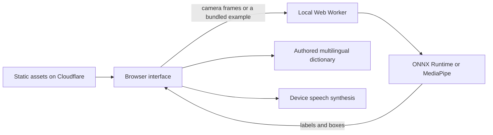

# Architecture

The server delivers files. Image inference runs on the user's device, inside a Web Worker. The app does not upload camera images to a recognition service. Initial asset downloads still use the network; this is not an offline-first guarantee. Speech synthesis uses voices supplied by the browser/device, which may use remote speech services.

- `app.mjs` owns camera lifecycle, model selection, user selection and speech.
- `selection.mjs` keeps an explicit selection and maps boxes to the displayed image.
- `public/expanded-worker.js` runs the expanded Open Images detector.
- `public/detector-worker.js` runs the standard COCO detector.
- Vocabulary modules map trained labels to authored translations; this is not general image captioning or arbitrary translation.
- `vite.config.mjs` allowlists static production files and retains obsolete chunks outside the output directory rather than deleting them.

No account, database, inference API credential or metered AI API is required. Browser camera access requires HTTPS or localhost. Model accuracy, available voices and performance depend on the scene and device.

The production output is `dist-detector/`. Source files, tests, conversion caches and private photographic test fixtures are outside that output. A build requires both model families to be prepared even if the user selects only one at runtime.
